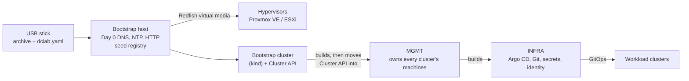

# DCiaB: DataCenter in a Box

**Walk into an empty data center with a USB stick and one YAML file. Leave with hypervisors installed, a self-managing Kubernetes management cluster, and the platform services every later cluster needs, all built offline from one signed, pinned archive.**

DCiaB is built to take a site from bare power and network to a running platform. It installs the hypervisors through their BMCs, builds a management cluster (MGMT) that runs Cluster API for every cluster including itself, and then builds the services cluster (INFRA), whose Argo CD configures everything after that from Git. You describe the site once, in `dciab.yaml`; every step reads that file and nothing else, and every step can be rerun.

**Status:** `r1alpha` (Day 0) in development; nothing has been released yet. What is built today: [docs/ROADMAP.md](docs/ROADMAP.md).

## Who it's for

- Platform teams standing up a new site, or rebuilding one, who want the same result every time instead of a runbook.
- Sites with no internet access, or none to rely on: everything installs from the archive, verified against its signature and pins.
- Proxmox VE and vSphere sites, existing or bare servers, with bare-metal (Metal3) clusters to follow. Each cluster uses one infrastructure provider.

## How it works

The bootstrap host is temporary. Its DNS addresses move to MGMT on Day 1 and its registry's images to INFRA at `finalize`, so nothing installed on Day 0 needs reconfiguring. The terms are in the [glossary](docs/GLOSSARY.md); what runs where is in [COMPONENTS.md](docs/COMPONENTS.md).

## Start here

| You want to | Read |
| --- | --- |
| Plan a site: what to decide and gather first | [docs/PLAN.md](docs/PLAN.md) |
| Run it, step by step, with checks | [docs/QUICKSTART.md](docs/QUICKSTART.md) |
| Write the config | [docs/CONFIG.md](docs/CONFIG.md) and [examples/](examples/) |
| Fix a step that stopped | [docs/TROUBLESHOOTING.md](docs/TROUBLESHOOTING.md) |
| Find any other page | [docs/README.md](docs/README.md) |
| Change DCiaB itself | [CONTRIBUTING.md](https://github.com/TrevorBenson/dciab/blob/main/CONTRIBUTING.md) in the source repository |

## The run at a glance

Each step has a page with its options and what it does. The bootstrap host is Rocky Linux 10: the DCiaB appliance on "server zero", or a host you provide ([PLAN.md](docs/PLAN.md#2-the-bootstrap-host)).

| # | Command | What it does | Stage |
| --- | --- | --- | --- |
| 1 | [`dciab validate`](docs/VALIDATE.md) | Checks the config offline, and against the site's services with `--live` | Day 0 |
| 2 | [`dciab media`](docs/MEDIA.md) | Copies and verifies the archive on the bootstrap host's work disk | Day 0 |
| 3 | [`dciab services`](docs/SERVICES.md) | Bare servers only: DNS, NTP and HTTP on the bootstrap host | Day 0 |
| 4 | [`dciab hypervisors`](docs/HYPERVISORS.md) | Bare servers only: installs the hypervisors through their BMCs | Day 0 |
| 5 | [`dciab templates`](docs/TEMPLATES.md) | Proxmox VE: publishes the node template from the archive, unless it is there | Day 0 |
| 6 | [`dciab seed`](docs/SEED.md) | The platform CA, the seed registry and the bootstrap cluster | Day 0 |
| 7 | [`dciab mgmt`](docs/MGMT.md) | Builds MGMT and moves Cluster API into it | Day 0 |
| 8 | `dciab infra` | Builds INFRA: Argo CD, Forgejo, OpenBao, CloudNativePG | Day 1 |
| 9 | `dciab platform` | Pushes the platform's repositories; Argo CD and OpenTofu bring up the rest | Day 1 |
| 10 | `dciab finalize` | Moves the images to INFRA's registry and retires the bootstrap host | Day 1 |

`dciab status` shows where the bootstrap stands at any point; every command is in [docs/CLI.md](docs/CLI.md).

## What you can rely on

- **One input.** `dciab.yaml` is the only input, and nothing site-specific has a default. Secrets are references to files or environment variables, never values in the config.
- **Offline and verified.** Every image, chart, binary and manifest comes from the archive, pinned in `bundle.lock` and checked by digest or checksum. The archive itself is signed.
- **Safe to rerun.** Every step can be rerun; a finished step changes nothing. `media`, `services` and `hypervisors` take `--print` to show their plan without changing anything.
- **Careful with what exists.** A server that may already hold an install is held, not wiped. DCiaB never changes a switch, and reaches existing hypervisors only through the API token or account in the config.
- **Recoverable.** Generated keys and passwords are sealed to at least two recipients' keys, and backups go to a target outside DCiaB's own clusters.
