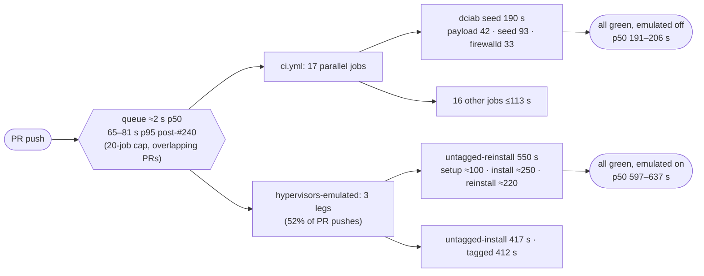

# CI baseline (2026-11-25 Pacific; data to 2026-11-26 02:00 UTC)

Review phase, read-only. Nothing here changes a workflow. Data: the GitHub Actions REST API
(`/actions/workflows/{id}/runs`, `/actions/runs/{id}/jobs`) and five job logs, pulled
2026-11-26 02:00 UTC. Scripts: see [How the numbers were made](#how-the-numbers-were-made).

**Prior pass.** [#240](https://github.com/TrevorBenson/dciab/pull/240) (issue #239, merged
2026-11-26 00:23 UTC) added `pytest -n auto`, split the emulated lab's untagged mode into two
legs, added `cancel-in-progress` for superseded PR runs, and set `timeout-minutes` everywhere.
It deferred, not rejected, "a cached pre-installed disk for the reinstall leg".
Numbers below are split **pre-#240** (larger sample, old pipeline) and **post-#240**
(the current pipeline, but a small sample: 10 `ci` runs, 7 emulated runs). Treat post-#240
p95 values as indicative only.

## 1. Pipeline map

No status check is required: the "Protect Main" ruleset's `required_status_checks` list is
empty. In practice a PR merges once every check is green, so the
critical path below runs from the push to the **last** check finishing.

| Workflow | Trigger | Jobs | Runner | Depends on |
| --- | --- | --- | --- | --- |
| `ci.yml` | every `pull_request`, push to `main` | 17 (16 jobs, one with a 2-leg Python matrix), all parallel, no `needs:` | GitHub-hosted (`ubuntu-latest` / `ubuntu-24.04`; 2 in a `rockylinux:10` container) | none |
| `hypervisors-emulated.yml` | `pull_request` / push to `main`, **path-filtered** (hypervisors, services, validate, schema, `bundle.lock`, `dciab`, …) | 3 matrix legs (`untagged-install`, `untagged-reinstall`, `tagged`), parallel | `ubuntu-24.04` with KVM | none |
| `node-image-boot.yml` | push to `main` (paths), dispatch | 1 | self-hosted lab runner | — |
| `lab.yml` → `lab-template/cluster/mgmt.yml` | dispatch | chained | self-hosted lab runner | `needs:` chain |
| `lab-runner-image.yml`, `lab-runner-smoke.yml`, `lab-appliance.yml` | push to `main` (paths), dispatch | 1 each | self-hosted lab runner | — |
| `archive.yml` | dispatch | 1 | hosted | — |

The lab workflows never run on a PR (refused by design, `tests/test_lab_runner.py`), so PR
feedback is `ci.yml` alone, or `ci.yml` + the emulated lab when the paths match.
**How often the emulated lab runs:** 25 of the 48 PR pushes (52%) since that workflow
existed also started it (measured, by head SHA).

### `ci.yml` jobs (post-#240 p50 duration)

| Job | p50 | What it is |
| --- | ---: | --- |
| dciab seed (DNS + Zot + kind from a payload) | 190 s | **long pole** |
| ClusterClass e2e (kind + CAPI) | 113 s | |
| tests (Python 3.9) / (Python 3.12) | 88 / 77 s | pytest -n auto |
| backup image | 86 s | build + tool checks |
| Proxmox VE per-host installer ISO | 77 s | |
| dciab services | 73 s | |
| Day 0 image preload | 61 s | |
| archive image inventory | 60 s | |
| charts | 57 s | |
| image digests, Redfish mockups, chrony image, media drop-in, Rocky 10 examples, shellcheck, frozen classes | 5–31 s | seven small jobs |

## 2. Critical path

Two shapes of PR push. Emulated lab off (48%): the seed job sets the time. Emulated lab on
(52%): the `untagged-reinstall` leg does.

| Path (PR push → last check green) | Pre-#240 p50 / p95 (n) | Post-#240 p50 / p95 (n) |
| --- | --- | --- |
| `ci.yml` only | 206 / 282 s (58) | 191 / 196 s (2) |
| `ci.yml` + emulated lab | 637 / 953 s (12) | 597 / 922 s (5) |
| `ci.yml` run alone (all events) | 209 / 271 s (80) | 193 / 236 s (9) |
| Emulated run alone | 644 / 800 s (16) | 571 / 886 s (7) |

Measured, success runs only. The post-#240 emulated p95 includes one re-attempted run.

## 3. Timing breakdown by bucket

### Path A: emulated lab off. Long pole: `dciab seed` job, 190 s p50

Step p50s from 10 post-#240 runs; the split inside `dciab seed` is from one job log
(job 139632010697, run 45736842263) and agrees with the step p50 (93 s).

| Bucket | Seconds | Share | Detail |
| --- | ---: | ---: | --- |
| Runner queue / provisioning | 2 (p95 81, all ci jobs) | 1% | |
| Checkout | 1–2 | 1% | |
| Dependency install | 8 | 4% | setup-python + `pip install pyyaml jsonschema` (≈4 s), `apt-get install dnsutils` (4 s) |
| Image pull / build | 42 | 22% | "Payload": `oras` pulls 1.7 GB of images + 415 MB of binaries + CRDs, every run, uncached |
| Compile / lint | 0 | 0% | |
| Tests: integration (the job's subject) | 136 | 71% | `dciab seed` 93 s (dns 10, registry 8, **kind 39**, **providers 36**), firewalld section 33 s (apt firewalld + seed rerun + checks), reruns/status/mgmt ≈10 s |
| Artifact upload/download | 0 | 0% | |
| Other | ≈2 | 1% | job setup, post steps |

The next jobs behind it: ClusterClass e2e 113 s (`helm/kind-action` 42 s, `hack/e2e/run.sh` 51 s),
unit tests 88 s. So shrinking the seed job buys at most ≈75 s before the ClusterClass e2e
sets the time.

### Path B: emulated lab on. Long pole: `untagged-reinstall` leg, 550 s p50

Step p50s from 7 post-#240 runs; scenario split from one job log (job 139635528680,
run 45736842265).

| Bucket | Seconds | Share | Detail |
| --- | ---: | ---: | --- |
| Runner queue / provisioning | 2 (p95 65, emulated legs) | 0–11% | |
| Checkout | 3 | 1% | |
| Dependency install | 43 | 8% | `apt-get install` qemu, libvirt, OVMF, python3-libvirt… |
| Image pull / build | 46 | 8% | ISO cache restore 14 s + check 3 s; **chrony + pve-assistant images built from scratch** 29 s |
| Compile / lint | 0 | 0% | |
| Tests: e2e (the leg's subject) | 442 | 80% | emulator setup 10 s; scenarios 432 s = first install ≈250 s, then reinstall ≈220 s, strictly sequential |
| Artifact upload/download | ≈5 | 1% | diagnostics |
| Other | ≈10 | 2% | job setup, report, post steps |

The other two legs take 412–417 s, so the reinstall leg is ≈135 s longer than the next one.

### Python test execution, for the record

`pytest -n auto` is 59–61 s p50 in the unit jobs, which finish at ≈90 s. It is **not on
either critical path** (0% of path A, 0% of path B). Locally (2 vCPU, `-n 2`): 1510 tests
collected in 2.7 s; 1478 passed, 32 skipped in 109 s wall with 87 s of user CPU, so the
suite is partly waiting, not CPU-bound. One test alone sleeps 25 s (findings.md, Q3).

## 4. Queue time and the 20-job cap

GitHub Free allows 20 concurrent jobs on standard hosted runners. One PR push that triggers
the emulated lab starts 17 + 3 = **20** jobs: exactly the cap, so any second run active at the
same time (another PR's push, or a post-merge `main` run) queues.

| | Jobs | Queued > 20 s | Hosted jobs already running when the queued ones were created |
| --- | ---: | ---: | --- |
| Pre-#240 | 1350 | 53 (4%) | 0–19 |
| Post-#240 | 220 | 45 (20%) | 12–20; never more than 20 running at once in the sample |

**Every one of the 45 post-#240 jobs that queued > 20 s was created while runs for more than
one head SHA were active** (measured: lane-g/h follow-ups, lane-i and lane-j PRs pushing
within minutes of each other). None queued because of a single push. Queue p95 (negative
values from re-runs clipped to 0): emulated legs 9 → **65 s**, `ci.yml` jobs 15 → **81 s**,
pre → post #240. A third emulated leg took the one-push total from 19 to exactly 20, so
any overlap now queues. Pre-#240 also peaked at exactly 20 running jobs.

Counts come from the fetched runs only; other workflows' jobs not in the sample would only
raise them. The cap is inferred from the plateau at exactly 20 plus GitHub's documented
limit; the account's plan isn't visible from the API used here.

## 5. Caches

| Cache | Key | Used by | Hit? |
| --- | --- | --- | --- |
| CRDs (`.cache/crds`, 4.9 MB) | `crds-<hash(bundle.lock)>` | tests ×2, charts, ClusterClass e2e, archive inventory | hit in the sampled logs |
| Proxmox ISO (1.7 GB) | `proxmox-iso-<sha>`, saved from main only | emulated legs | hit (14 s restore) |
| pip, apt, podman layers, the seed payload | none | — | — |

The seed job, `day0-preload` and the archive payload steps call `hack/fetch_crds.py`
without the CRD cache (5 s uncached, measured locally). The cache list and hit rates over
all runs couldn't be read: `/actions/caches` wasn't reachable from the environment used
(findings.md, "Data I couldn't get").

## How the numbers were made

- Runs: last 100 completed `ci` runs (2026-11-24 15:49 → 2026-11-26 01:35 UTC), 32 emulated,
  17 lab-runner-image, 8 node-image-boot. `lab.yml` had none completed.
- Percentiles: linear interpolation over success runs and success jobs. Queue = job
  `started_at − created_at`; duration = `completed_at − started_at`; path = last job
  `completed_at` − run `created_at` (earliest of both workflows for a head SHA).
- Pre/post split: run `created_at` before/after #240's merge (2026-11-26 00:23:26 UTC).
- Queries (REST, `gh api`), so anyone can redo this:
  - `repos/TrevorBenson/dciab/actions/workflows/{ci.yml,hypervisors-emulated.yml}/runs?status=completed&per_page=100`
  - `repos/TrevorBenson/dciab/actions/runs/{run_id}/jobs?per_page=100` (jobs and steps with timestamps)
  - `repos/TrevorBenson/dciab/actions/jobs/{job_id}/logs` (the phase splits)
  - `repos/TrevorBenson/dciab/pulls?head=TrevorBenson:{branch}&state=all` and `pulls/{n}/files` (what PRs touch)
- The analysis was a throwaway script; recommendation O1 turns it into a workflow in the repo.
- **Path A** in recommendations.md is the `ci.yml` run alone (all events, post-#240, n=9:
  193 s), because only 2 post-#240 PR pushes ran `ci.yml` without the emulated lab.
